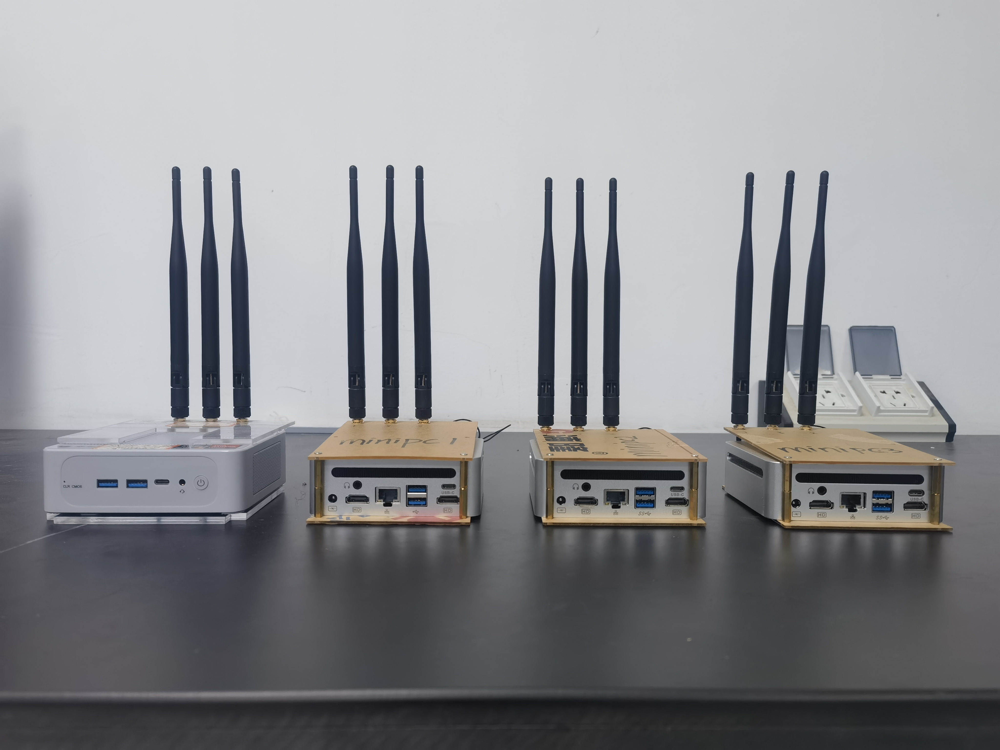
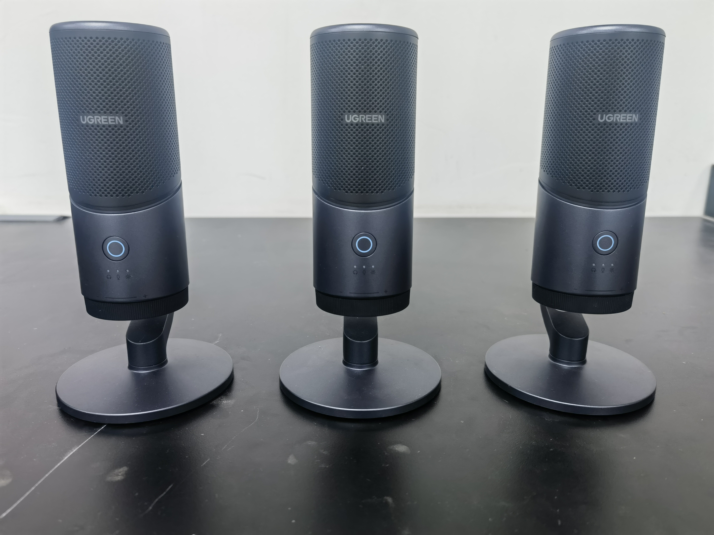
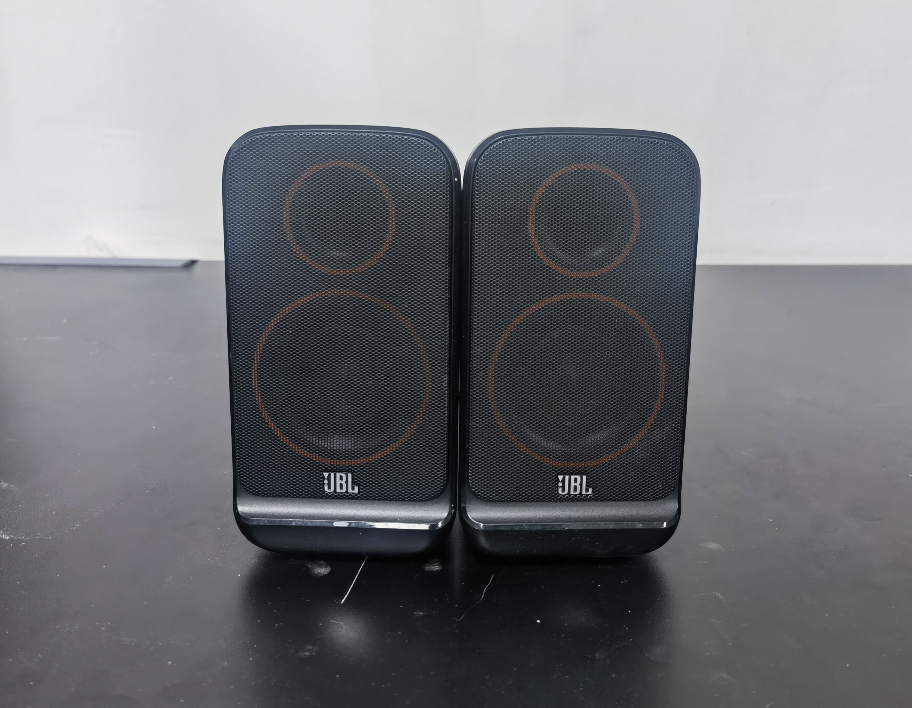
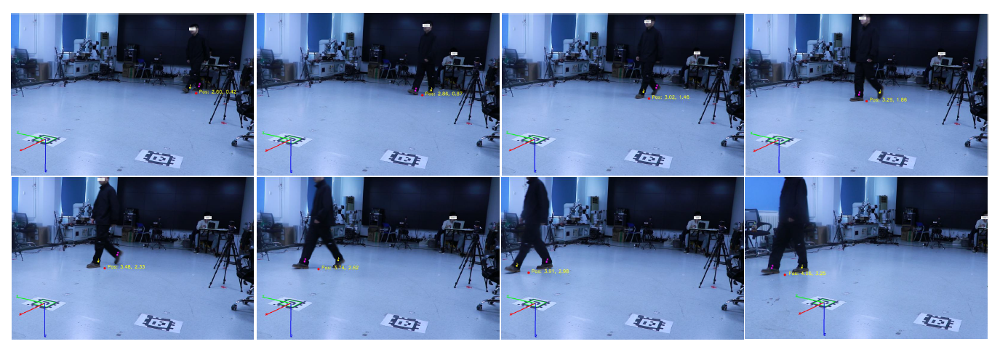

# XGait Data Collection Tutorials

This directory contains tutorials and tools for collecting and processing the three modalities of XGait: WiFi CSI, Acoustic signals, and Video data.

## Directory Structure

### [Wi-Fi/](./Wi-Fi/README.md)
WiFi CSI data collection setup and scripts.

- **Configuration/**: MiniPC setup guide (drivers, kernel configuration)
- **Scripts/**: Receiver and Transmitter scripts for CSI data collection

### [Acoustic/](./Acoustic/README.md)
Distributed acoustic signal recording system.

- **Client_Server/**: Client and server code for synchronized acoustic recording

  

    
    
<b>Microphone</b>

  

  

    
    
<b>Speaker</b>

  

### [Video/](./Video/)
Video processing tools for ground truth trajectory extraction.

- **VideoTrackExtraction/**: Tools for camera calibration, trajectory extraction, and visualization

## Quick Start

1. **WiFi Setup**: See [Wi-Fi/Configuration/minipc_setup_guide.md](./Wi-Fi/Configuration/minipc_setup_guide.md)
2. **Acoustic Recording**: See [Acoustic/README.md](./Acoustic/README.md)
3. **Video Processing**: See [Video/VideoTrackExtraction/README.md](./Video/VideoTrackExtraction/README.md)

For details on feature extraction and model training, see [src/USER_GUIDE.md](../../src/USER_GUIDE.md).
